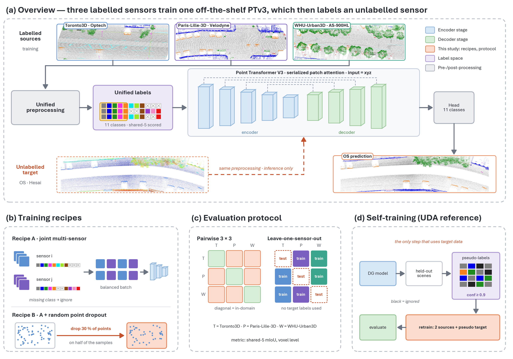
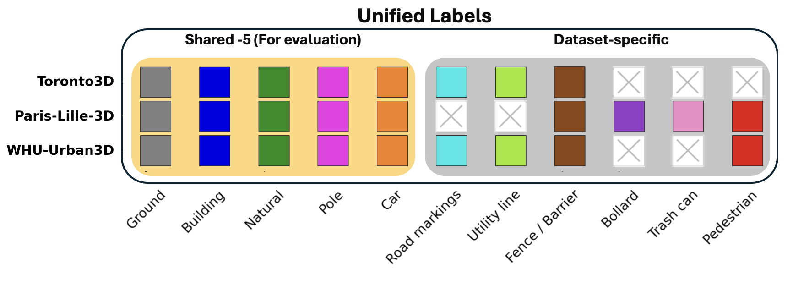
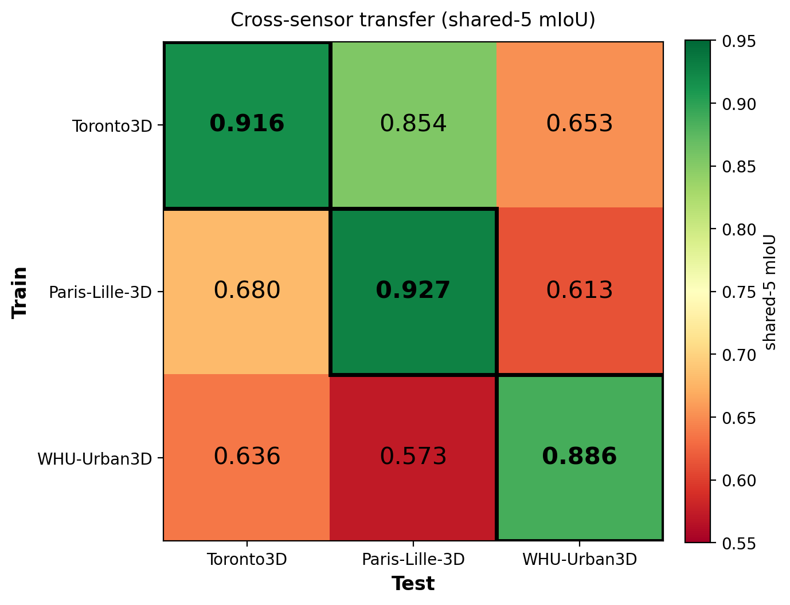
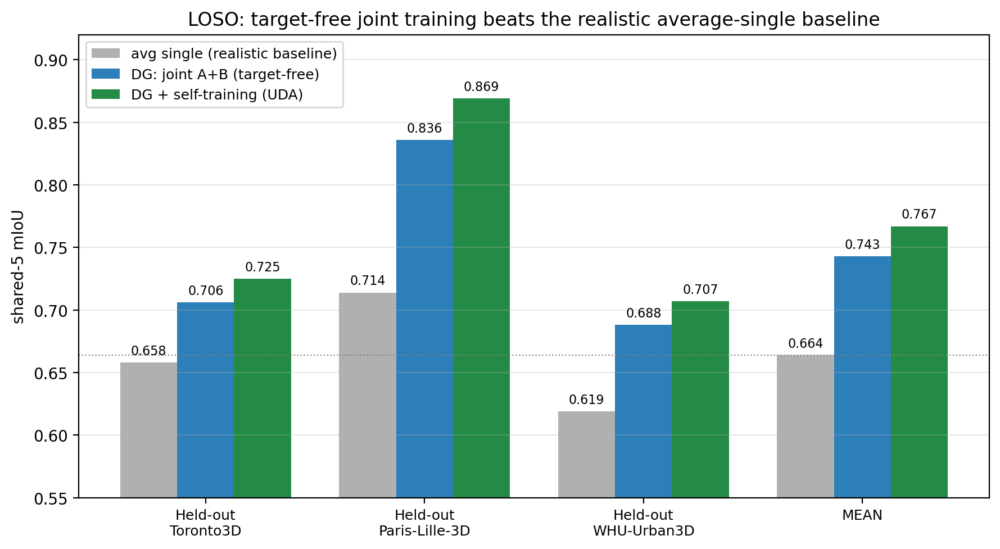
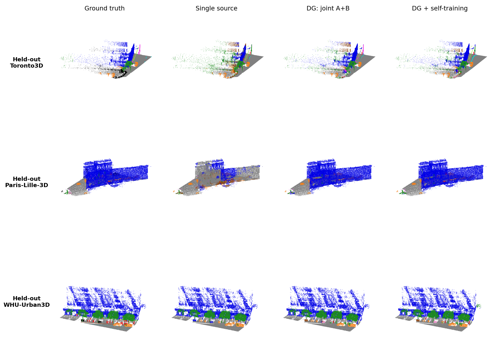

# Cross-Sensor Generalization of MLS Point-Cloud Semantic Segmentation

Code, configurations, and trained weights for the paper *Cross-Sensor Generalization of MLS Point-Cloud Semantic Segmentation* (June Moh Goo, Zichao Zeng, Stefano Cavazzi, James Gillespie, Jan Boehm; under submission to *Remote Sensing*).

A model trained on one mobile laser scanning (MLS) sensor loses accuracy on another, because each LiDAR samples the scene differently. We study this with three labelled MLS sensors and one unlabelled operational target, an Ordnance Survey point cloud of Southampton captured with a Hesai PandarXT-32, and give a simple target-free baseline: train one off-the-shelf Point Transformer V3 on several labelled sensors at once.



---

## The problem

| Dataset | Role | Sensor | Labels |
|---|---|---|---|
| Toronto3D | labelled source | Optech Maverick | 8 classes |
| Paris-Lille-3D | labelled source | Velodyne HDL-32E | 9 classes |
| WHU-Urban3D (MLS-S) | labelled source | AS-900HL, survey-grade | 18 classes |
| OS Southampton | unlabelled target | Hesai PandarXT-32 | none |

Applied to the Ordnance Survey cloud, every single-source model fails, and each fails differently.


## Unified label space

The three taxonomies are mapped to one 11-class space. A class a source does not annotate is ignored there, not forced into a wrong class. Five classes are annotated by all sources (ground, building, natural, pole, car). Every cross-sensor score in this repository is the mean IoU over these five, called **shared-5**.



---

## Results

**Cross-sensor gap.** In-domain shared-5 mIoU averages 0.91 and falls to 0.67 across sensors. The loss concentrates on poles and buildings. All WHU-Urban3D scores use the corrected v1.1 labels.

<p align="center"></p>

**Joint multi-sensor training (leave-one-sensor-out).** Training on the two remaining sensors beats the average single source on every held-out sensor, without any target labels.

| Held-out mean, shared-5 mIoU | single seed | 3 seeds |
|---|---|---|
| Average single source (realistic baseline) | 0.668 | 0.668 |
| Joint training, Recipe B (target-free) | 0.749 | 0.747 ± 0.003 |
| + one self-training step on the target | 0.772 | 0.769 ± 0.005 |
| Best single source (oracle, needs target labels) | 0.729 | |

Joint training gains **+0.079 ± 0.003** over the average single source and reaches about **97 %** of the self-training score without touching the target.




**Intensity** helps reflectance-defined classes such as road marking in domain. Across sensors it helps only when each cloud is standardized with its own statistics, and then unevenly, so all cross-sensor models use coordinates only.

---

## Trained weights

Weights-only checkpoints (about 185 MB each) are on Hugging Face: **https://huggingface.co/jmgoo1118/mls-cross-sensor-segmentation**

| File | Trained on | Config |
|---|---|---|
| `single_{toronto3d,parislille3d,whuurban3d}_coord.pth` | one source | `configs/semseg-pt-v3-{,npm3d-,whu-}coord.py` |
| `loso_heldout_<sensor>_recipeB.pth` | the other two sources, Recipe B | `configs/semseg-pt-v3-loso{1,2,3}b-AB-coord.py` |
| `selftrain_heldout_<sensor>.pth` | the other two sources + pseudo-labelled held-out sensor | `configs/semseg-pt-v3-uda-<sensor>-coord.py` |
| `deploy_threesource_recipeB.pth` | all three sources, Recipe B (use this for a new sensor) | `configs/semseg-pt-v3-all3-AB-coord.py` |

```bash
hf download jmgoo1118/mls-cross-sensor-segmentation --local-dir weights/
```

---

## Installation

- Python 3.10, PyTorch 2.5 + CUDA 12.4
- [Pointcept](https://github.com/Pointcept/Pointcept) (clone separately) with `pointops` and `spconv`, optional `flash-attn`
- `numpy`, `scipy`, `plyfile`, `laspy[lazrs]`, `h5py`, `matplotlib`, `huggingface_hub`

```bash
conda create -n pointcept python=3.10 -y && conda activate pointcept
# install torch 2.5 / cu124, then the Pointcept ops (pointops, spconv) following their README
pip install numpy scipy plyfile "laspy[lazrs]" h5py matplotlib huggingface_hub
# Pointcept at the exact commit used in the paper, cloned next to this repository
git clone https://github.com/Pointcept/Pointcept.git
cd Pointcept && git checkout d7272257058337969292865e0892b91d2f362b6a && cd ..
git clone https://github.com/junegoo94/mls-cross-sensor-segmentation.git
```

No paths need editing. Every script finds this repository from its own location and expects Pointcept in a sibling folder named `Pointcept`. To use another location, set `POINTCEPT_ROOT`. Raw datasets are passed as command-line arguments. `scripts/train.sh` uses the `python` of the active environment (or `$PYTHON`).

## Data

- Toronto3D: https://github.com/WeikaiTan/Toronto-3D
- Paris-Lille-3D: https://npm3d.fr/paris-lille-3d
- WHU-Urban3D: https://whu3d.com (we use the MLS-S part, city A)
- The Ordnance Survey Southampton point cloud is proprietary and not publicly available.

---

## Usage

### 1. Preprocess
Every cloud goes through the same pipeline: 5 cm voxel grid, per-cloud offset, per-cloud intensity z-score, 50 m tiles.
```bash
python preprocess/preprocess_toronto3d.py --input_root <Toronto3D>/initial_point_clouds
python preprocess/preprocess_npm3d.py     --input_root <Paris-Lille-3D>/training_10_classes
python preprocess/preprocess_whu3d.py     --input_root <WHU-Urban3D>/mls/h5
python preprocess/build_loso.py               # unified-label copies and leave-one-sensor-out splits
python preprocess/build_loso_balanced.py      # LOSO with equal chunks per sensor (Recipes A and B)
python preprocess/build_all3_balanced.py      # all three sensors, for the deployment model
```

### 2. Train
Each config pins the random seed of the run reported in the paper. GPU kernels are not fully deterministic, so a rerun matches the paper within the seed-to-seed spread we report (about ±0.01 shared-5 mIoU).
```bash
# bash scripts/train.sh <config> <experiment name> [num_gpus]
bash scripts/train.sh configs/semseg-pt-v3-loso3b-AB-coord.py loso3b-AB-coord 2
```
Checkpoints and logs are written to `exp/<experiment name>/`. Training takes about 65 minutes per model on two RTX 3090 GPUs.

### 3. Evaluate on a held-out sensor
```bash
python scripts/eval_heldout.py --cfg configs/semseg-pt-v3-loso3b-AB-coord.py \
    --weight weights/loso_heldout_whuurban3d_recipeB.pth --val data/whu3d/val --tag whu_heldout
python scripts/xsensor_3x3.py        # full 3x3 transfer matrix
python scripts/loso_eval_ab.py       # LOSO, Recipe B, against the single-source baselines
```
Run all commands from the repository root.
All scores are shared-5 mIoU at the voxel level without test-time augmentation.

### 4. Seed replicates and self-training
```bash
SEEDS="1 2" bash scripts/run_seeds.sh     # Recipe B and self-training with extra seeds (resumable)
python scripts/summarize_seeds.py         # mean ± std of the gains
```
Self-training alone: `scripts/pseudo_label.py` (confidence ≥ 0.9) → `scripts/build_uda_combined.py` → train with `configs/semseg-pt-v3-uda-<sensor>-coord.py`.

### 5. Label a new point cloud
```bash
python preprocess/preprocess_osdata.py --input_root <dir with .laz> --output_root data/target
python scripts/infer_osdata_joint.py --config configs/semseg-pt-v3-all3-AB-coord.py \
    --weight weights/deploy_threesource_recipeB.pth --tag all3 --data_root data/target --out_dir exp/target_pred
python scripts/color_predictions.py       # optional: bake the unified class colours into the .laz
```
Predictions are made on 5 cm voxels and propagated back to every input point by nearest neighbour. Inference runs in fp32.

---

## Reproducing the paper

| Result | Script | Models (config) |
|---|---|---|
| Class balance per source | `scripts/class_prevalence.py` | none |
| Sampling statistics per sensor | `scripts/sensor_sampling_stats.py --toronto … --paris … --whu …` | none |
| In-domain results (Toronto3D, Paris-Lille-3D) | `train.log` of each run (Pointcept test at the end of training) | `semseg-pt-v3-{,npm3d-}coord{,-intensity}.py` |
| In-domain results (WHU-Urban3D) | `scripts/whu_val_clean.py` | `semseg-pt-v3-whu-coord{,-intensity}.py` |
| 3x3 cross-sensor transfer and heatmap | `scripts/xsensor_3x3.py` | single-source coord models |
| LOSO per-class results and summary, Recipe B | `scripts/loso_eval_ab.py` | `semseg-pt-v3-loso{1,2,3}b-AB-coord.py` |
| Ablation: Recipe A, unbalanced and balanced | `scripts/loso_eval.py`, `scripts/loso_eval_b.py` | `loso{1,2,3}-coord.py`, `loso{1,2,3}b-coord.py` |
| Held-out means with self-training | `scripts/pseudo_label.py` → `build_uda_combined.py` → train → `eval_heldout.py` | `semseg-pt-v3-uda-<sensor>-coord.py` |
| Three-seed statistics | `scripts/run_seeds.sh`, `scripts/summarize_seeds.py` | as above, seeds 1 and 2 |
| WHU-Urban3D label correction | built into `preprocess/preprocess_whu3d.py` | none |

---

## Repository structure

```
preprocess/   per-dataset preprocessing, unified labels, joint and LOSO splits
configs/      PTv3 configs: single-source, joint, LOSO (Recipe A / A+B), self-training, intensity variants
scripts/      training launcher, inference, evaluation, seed replicates, sensor sampling statistics
assets/       figures used in this README
```

## Acknowledgements

This work was funded by EPSRC through an industrial CASE studentship with Ordnance Survey. It builds on [Pointcept](https://github.com/Pointcept/Pointcept) and Point Transformer V3, and uses the Toronto3D, Paris-Lille-3D, and WHU-Urban3D datasets.
