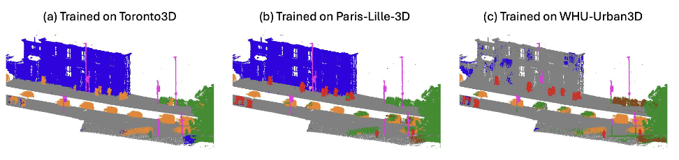

# Cross-Sensor Generalization of MLS Point-Cloud Semantic Segmentation

Semantic segmentation of **mobile laser scanning (MLS)** point clouds that must transfer **between LiDAR sensors**. We train on public labelled MLS datasets and apply the model to an **unlabelled Ordnance Survey (OS) cloud of Southampton**, captured with a sensor absent from every public dataset. The study is a controlled **four-sensor** benchmark with a simple, target-free multi-sensor baseline.

Built on [Pointcept](https://github.com/Pointcept/Pointcept) with the **Point Transformer V3 (PTv3)** backbone, used off the shelf.

---

## The problem

Different LiDAR units sample a scene with different beam geometries and report intensity on different scales. A model trained on one sensor overfits that scan pattern and loses accuracy on another. This is acute when the target is unlabelled and comes from a sensor unlike any labelled data, which is exactly the OS case.

| Dataset | Role | Sensor | Labels |
|---|---|---|---|
| Toronto3D | source | Teledyne Optech Maverick | yes |
| Paris-Lille-3D (NPM3D) | source | Velodyne HDL-32E | yes |
| WHU-Urban3D | source | Shanghai MLS-S (survey-grade) | yes |
| **OS (Southampton)** | **target** | **Hesai PandarXT-32** | **none** |


*Each single-source model applied to OS without adaptation. No single source works, and each fails differently.*

---

## Unified label space

The three sources use 8, 9, and 18 classes. We remap all of them to one **11-class** space. A class a source does not annotate is set to an **ignore** label there, not a wrong class, so supervision is partial per source while the model always predicts all 11 classes.

Five classes are annotated by all three sources: **Ground, Building, Natural, Pole, Car**. These form **shared-5**, and every cross-sensor number is computed on shared-5 so each transfer direction is scored on the same label set.


---

## Key findings

**Q1. The cross-sensor gap is large.** In a 3x3 transfer matrix, in-domain accuracy averages **0.91** mean IoU and falls to **0.66** across sensors, a drop of about **0.25**.


**Q2. The loss is class-dependent.** It concentrates on scan-pattern-dependent classes such as poles, cars, and buildings on the most dissimilar sensor, while ground and vegetation transfer well.

**Q3. Target-free multi-sensor training helps.** Under a leave-one-sensor-out (LOSO) protocol, joint training on the available sources raises the held-out shared-5 mIoU by **+0.079** over the realistic average-single baseline (0.664 to 0.743). A standard self-training step on the unlabelled target adds a further **+0.024** (to 0.767), so target-free training already reaches about **97%** of what target-adaptive self-training achieves.


*Held-out sensor, left to right: ground truth, single source, joint A+B (target-free), joint + self-training.*

**Q4. Intensity does not transfer.** It helps only reflectance-defined classes such as road markings and is the least transferable channel, so all cross-sensor experiments use geometry only (`coord`).

We also found and corrected a building-as-pedestrian labelling error in WHU-Urban3D with a simple height rule (any pedestrian instance taller than 2.5 m is ignored).

---

## Recipes

- **A** = joint training on several source sensors in the unified label space.
- **B** = density augmentation (random point dropout) on top of A, to mimic density and beam differences.
- **A+B** = the full recipe used for deployment on OS.

---

## Pipeline

```
raw tiles (.ply / .laz)
   |  preprocess/  -- 0.05 m voxel, per-cloud intensity z-score, 50 m chunks
   v
Pointcept DefaultDataset  (coord / strength / segment .npy per scene)
   |  configs/ + Pointcept tools/train.py  -- PTv3, CE + Lovasz
   v
trained model (model_best.pth)
   |  scripts/infer_osdata*.py  -- voxel forward + KDTree back-projection to full-res
   v
labelled .laz
   |  scripts/color_predictions.py  -- bake unified RGB
   v
coloured .laz (view in CloudCompare)
```

Two normalisations make cross-sensor transfer work:
- **Coordinates:** subtract a per-cloud min offset, then store `float32` (large UTM/BNG values lose precision otherwise).
- **Intensity:** per-cloud z-score `(x - mu) / sigma`, so each sensor lands at mean 0, std 1.

Voxel downsampling keeps one real point per 0.05 m voxel. 50 m chunks are formed from occupied grid cells.

---

## Repository structure

```
preprocess/
  preprocess_toronto3d.py     Toronto3D   -> DefaultDataset
  preprocess_npm3d.py         Paris-Lille-3D
  preprocess_whu3d.py         WHU-Urban3D
  preprocess_osdata.py        OS .laz     -> inference chunks
  build_joint_dataset.py      unified 11-class joint set (recipe A)
  build_loso.py               leave-one-sensor-out splits
  build_loso_balanced.py      LOSO with equal chunks per sensor
configs/
  semseg-pt-v3-<src>-coord{,-intensity}.py   single-source (Toronto / npm3d / whu)
  semseg-pt-v3-joint-coord{,-intensity}.py   joint (recipe A)
  semseg-pt-v3-<src>-coord-augB.py           single-source + density aug (recipe B)
  semseg-pt-v3-all3-AB-coord.py              all sources, A+B (OS deployment model)
  semseg-pt-v3-loso{1,2,3}{,b}{,-AB}-coord.py  LOSO, recipe A and A+B
  semseg-pt-v3-uda-<target>-coord.py         self-training on the held-out target
scripts/
  train.sh                    Pointcept training launcher (multi-GPU)
  infer_osdata*.py            inference -> labelled .laz (+ top-view PNG)
  color_predictions.py        bake unified RGB into predicted .laz
  val_infer.py                in-domain validation inference
  cross_sensor_eval.py        pairwise shared-5 mIoU (one source -> one target)
  xsensor_3x3.py              full 3x3 cross-sensor matrix (Q1, Q2)
  loso_eval.py                LOSO evaluation, recipe A
  loso_eval_ab.py             LOSO evaluation, recipe A+B (Q3)
  pseudo_label.py             confidence-filtered pseudo-labels on the target
  build_uda_combined.py       sources + pseudo-labelled target -> UDA set
  uda_eval.py                 self-training evaluation (Q4)
  export_4629_corrected.py    WHU-Urban3D label-error correction (height rule)
  plot_curves.py              parse train.log -> loss / val-mIoU curves
  eval_heldout.py             shared-5 evaluation of one checkpoint on a held-out sensor
  sensor_sampling_stats.py    raw per-sensor density / NN spacing / voxel survival (Table: sampling)
  gen_seed_configs.py, run_seeds.sh, summarize_seeds.py   seed replicates of LOSO Recipe B and self-training
  release_weights.sh          publish the weights-only checkpoints as a GitHub release
assets/                       figures used in this README
```

> Data (`data/`) and experiment outputs (`exp/`) are not tracked (see `.gitignore`).

## Pretrained weights

Weights-only checkpoints (PTv3, coordinates-only input, about 185 MB each) are published as GitHub release `v1.0-weights`. Each file stores `{"state_dict": ...}` with the `module.` prefix removed and loads into the model built from the matching config.

| File | Trained on | Config |
|---|---|---|
| `single_{toronto3d,parislille3d,whuurban3d}_coord.pth` | one source | `semseg-pt-v3-{,npm3d-,whu-}coord.py` |
| `loso_heldout_<sensor>_recipeB.pth` | the other two sources, Recipe A+B | `semseg-pt-v3-loso{1,2,3}b-AB-coord.py` |
| `selftrain_heldout_<sensor>.pth` | the other two sources + pseudo-labelled held-out sensor | `semseg-pt-v3-uda-<sensor>-coord.py` |
| `deploy_threesource_recipeB.pth` | all three sources, Recipe A+B (OS deployment) | `semseg-pt-v3-all3-AB-coord.py` |

The model fitted with Southampton pseudo-labels is not released (proprietary target data). Evaluate a checkpoint on a held-out sensor with `scripts/eval_heldout.py`.

---

## Requirements

- Python 3.10, **PyTorch 2.5 + CUDA 12.4**
- [Pointcept](https://github.com/Pointcept/Pointcept) (clone separately) with `pointops`, `spconv`, optional `flash-attn`
- `numpy`, `plyfile`, `laspy[lazrs]`, `scipy`, `matplotlib`
- Tested on 2 x RTX 3090 (24 GB), about 65 min per model

```bash
conda create -n pointcept python=3.10 -y
conda activate pointcept
# install torch 2.5 / cu124, then Pointcept ops (pointops, spconv) per their README
pip install numpy plyfile "laspy[lazrs]" scipy matplotlib
export PYTHONPATH=/path/to/Pointcept
```

> Scripts and configs use absolute paths for the local machine. Adjust them, or point `PYTHONPATH` at your Pointcept clone.

---

## Data (not included)

- **Toronto3D** — https://github.com/WeikaiTan/Toronto-3D
- **Paris-Lille-3D / NPM3D** — https://npm3d.fr
- **WHU-Urban3D** — https://whu3d.com
- **OS** — proprietary (Ordnance Survey)

---

## Usage

```bash
# 1. Preprocess each source, then build the training sets
python preprocess/preprocess_toronto3d.py --input_root <toronto_dir>
python preprocess/preprocess_npm3d.py     --input_root <npm3d_dir>
python preprocess/preprocess_whu3d.py     --input_root <whu_dir>
python preprocess/preprocess_osdata.py    --input_root <os_laz_dir>
python preprocess/build_joint_dataset.py            # recipe A
python preprocess/build_loso.py                     # LOSO splits

# 2. Train (Pointcept). Outputs land in exp/<exp_name>/
bash scripts/train.sh configs/semseg-pt-v3-all3-AB-coord.py all3-AB-coord 2

# 3. Cross-sensor evaluation (shared-5 mIoU)
python scripts/xsensor_3x3.py            # Q1, Q2: the 3x3 matrix
python scripts/loso_eval_ab.py           # Q3: LOSO, recipe A+B

# 4. Deploy on OS and colour for viewing
python scripts/infer_osdata_joint.py --config configs/semseg-pt-v3-all3-AB-coord.py \
  --weight exp/all3-AB-coord/model/model_best.pth --out_dir exp/osdata_infer_all3
python scripts/color_predictions.py      # bake unified RGB -> *_rgb.laz
```

Open the `_rgb.laz` in CloudCompare and display **Colors → RGB**.

---

## Notes

- **Inference runs in fp32.** fp16/autocast breaks the spconv inference tuner; training in fp16 is fine.
- **OS has no ground truth.** OS predictions are qualitative. All quantitative numbers use the labelled sources under the cross-sensor protocol.
- Features are **coord** (`in_channels=3`) or **coord + intensity** (`in_channels=4`). Cross-sensor experiments use coord only (Q4).

---

## Acknowledgements

- [Pointcept](https://github.com/Pointcept/Pointcept) and **Point Transformer V3** (Wu et al., CVPR 2024)
- [Toronto3D](https://github.com/WeikaiTan/Toronto-3D), [Paris-Lille-3D / NPM3D](https://npm3d.fr), [WHU-Urban3D](https://whu3d.com)
- Ordnance Survey (target survey data)
