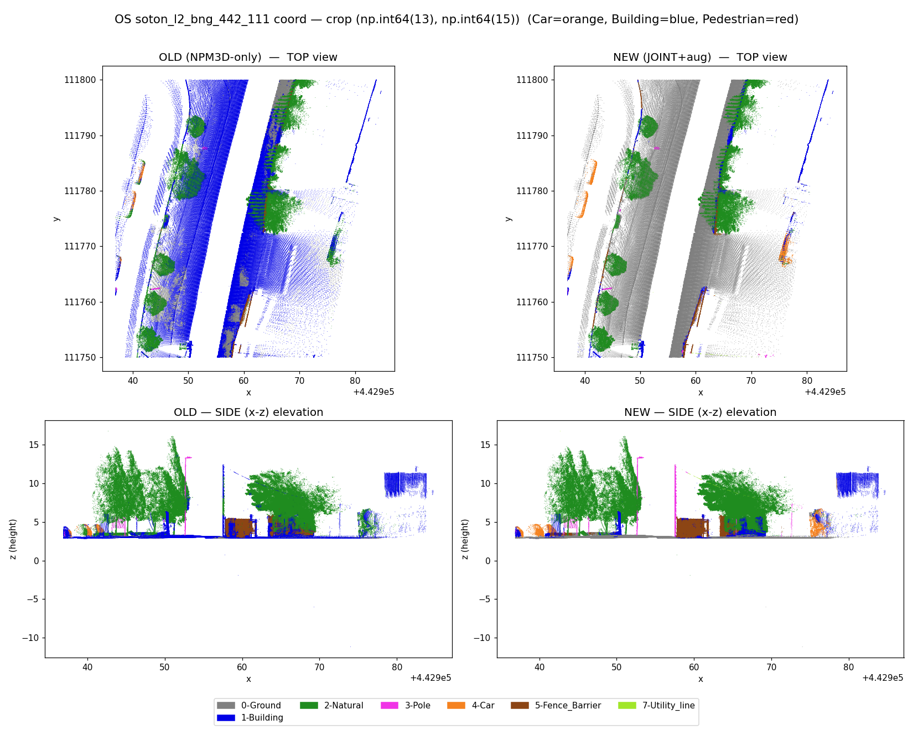
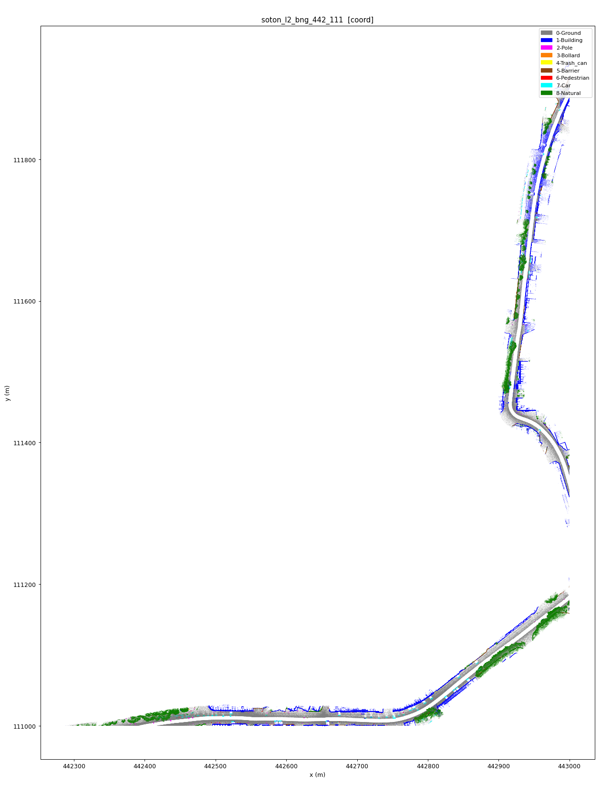
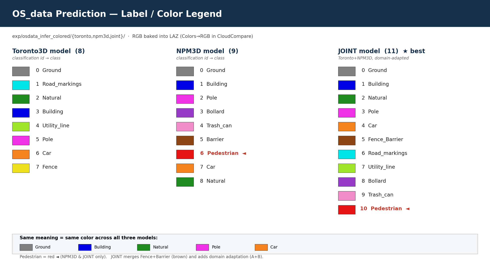

# Cross-Domain Semantic Segmentation of RGB-less MLS Point Clouds

Semantic segmentation of **Ordnance Survey (OS) mobile-laser-scanning (MLS) point clouds** that have **no RGB and no labels**, by transferring models trained on public labeled MLS datasets (**Toronto3D**, **Paris-Lille-3D / NPM3D**) — with a focus on **cross-sensor domain adaptation**.

Built on [Pointcept](https://github.com/Pointcept/Pointcept) with the **Point Transformer V3 (PTv3)** backbone.

---

## Why this project

OS surveys cities with a **Hesai PandarXT-32** LiDAR and provide only geometry + intensity (no colour, no labels). We want per-point semantics (ground, building, vegetation, pole, car, pedestrian, …).

The approach: train on a **labeled** MLS dataset, then **infer on OS data**. The catch is that the labeled datasets were captured with **different LiDAR sensors**, so the model must generalise across sensors.

| Dataset | Role | Sensor | RGB | Labels |
|---|---|---|---|---|
| Toronto3D | source | Teledyne Optech Maverick (32-line) | yes (dropped) | yes |
| Paris-Lille-3D (NPM3D) | source | Velodyne HDL-32E | no | yes |
| **OS_data (Southampton)** | **target** | **Hesai PandarXT-32** | no | **none** |

Even though all three are 32-beam spinning MLS, their **scan patterns differ** (vertical FOV, beam spacing, density), which a geometry-reliant model overfits — the core problem this repo studies.

---

## Key results (illustrative)

**1. Cross-sensor domain shift, and a label-free fix.**
A model trained on one sensor mislabels large flat regions (road / sidewalk / car sides → *Building*) on a different sensor. Training jointly on **both** source sensors + density augmentation fixes most of it — **no target labels needed**.


*Left: single-source model (road wrongly blue=Building). Right: joint + augmentation (road correctly grey=Ground). Top = bird's-eye, bottom = side elevation.*

**2. OS prediction with recovered pedestrian class** (class 6 = Pedestrian, red):



**3. Unified colour scheme** across all models (same meaning → same colour):



---

## Pipeline

```
raw tiles (.ply / .laz)
   │  preprocess/  ── 0.05 m voxel · per-cloud intensity z-score · 50 m chunks
   ▼
Pointcept DefaultDataset  (coord / strength / segment .npy per scene)
   │  configs/ + Pointcept tools/train.py  ── PTv3, CE + Lovász
   ▼
trained model (model_best.pth)
   │  scripts/infer_osdata*.py  ── voxel forward + KDTree back-projection to full-res
   ▼
labeled .laz  +  top-view PNG
   │  scripts/color_predictions.py  ── bake unified RGB
   ▼
coloured .laz (view in CloudCompare)
```

Two normalisations make cross-dataset/cross-sensor transfer work:
- **Coordinates:** subtract a per-cloud min offset, then store `float32` (large UTM/BNG values lose cm precision in `float32` otherwise).
- **Intensity:** **per-cloud z-score** `(x − μ)/σ` so each sensor's intensity lands at mean 0 / std 1.

Voxel downsampling keeps **one real point per 0.05 m voxel** (first-point, not averaged) so coordinate / intensity / label stay consistent. 50 m chunks are formed by binning points into occupied grid cells (empty space gets no chunk).

---

## Repository structure

```
preprocess/
  preprocess_toronto3d.py     Toronto3D .ply  -> DefaultDataset
  preprocess_npm3d.py         Paris-Lille-3D  -> DefaultDataset
  preprocess_osdata.py        OS .laz         -> inference chunks
  build_joint_dataset.py      Toronto + NPM3D -> unified 11-class joint set
  inspect_tile.py             quick tile inspector
configs/
  semseg-pt-v3-coord{,-intensity}.py          Toronto3D (8 cls)
  semseg-pt-v3-npm3d-coord{,-intensity}.py    NPM3D (9 cls)
  semseg-pt-v3-joint-coord{,-intensity}.py    JOINT (11 cls, + density aug)
  semseg-pt-v3-{,npm3d-}coord-augB.py         single-source + augmentation
scripts/
  train.sh                    Pointcept training launcher (multi-GPU)
  infer_osdata.py             inference (Toronto model) -> labeled .laz + PNG
  infer_osdata_npm3d.py       inference (NPM3D model, 9 cls)
  infer_osdata_joint.py       inference (JOINT model, 11 cls)
  color_predictions.py        bake unified RGB into predicted .laz
  compare_joint_vs_npm3d.py   point-to-point before/after comparison + crop
  cross_sensor_eval.py        quantitative cross-sensor mIoU (shared classes)
  plot_curves.py              parse train.log -> loss / val-mIoU curves
notes/
  *.md                        write-ups (report, experiment plan, results)
  make_figs_all.py, make_legend_pdf.py, build_*.py   figure / report generators
assets/                       curated images used in this README
```

> Data (`data/`) and experiment outputs (`exp/`) are **not** tracked (see `.gitignore`).

---

## Requirements

- Python 3.10, **PyTorch 2.5 + CUDA 12.4**
- [Pointcept](https://github.com/Pointcept/Pointcept) (clone separately) with `pointops`, `spconv`, optional `flash-attn`
- `numpy`, `plyfile`, `laspy[lazrs]`, `scipy`, `matplotlib`
- Tested on 2 × RTX 3090 (24 GB)

```bash
# example conda env
conda create -n pointcept python=3.10 -y
conda activate pointcept
# install torch 2.5 / cu124, then Pointcept ops (pointops, spconv) per their README
pip install numpy plyfile "laspy[lazrs]" scipy matplotlib
```

> **Paths:** scripts/configs currently use absolute paths (`/home/.../projects/os_seg`, `/home/.../projects/Pointcept`). Adjust them to your machine, or set `PYTHONPATH` to your Pointcept clone. `train.sh` documents the expected env at the top.

---

## Data layout (datasets not included)

Public sources:
- **Toronto3D** — https://github.com/WeikaiTan/Toronto-3D
- **Paris-Lille-3D / NPM3D** — https://npm3d.fr
- **OS_data** — proprietary (Ordnance Survey)

Expected raw locations (override via each script's `--input_root`):
```
Toronto3D   *.ply  (x y z, RGB, intensity, label)
NPM3D       training_10_classes/*.ply  (x y z, reflectance, class)
OS          *.laz  (x y z, intensity; RGB = 0)
```

---

## Usage

### 1. Preprocess
```bash
python preprocess/preprocess_toronto3d.py --input_root <toronto_ply_dir>
python preprocess/preprocess_npm3d.py     --input_root <npm3d_dir>/training_10_classes
python preprocess/preprocess_osdata.py    --input_root <os_laz_dir> --files soton_l1.laz soton_l2.laz
# optional: joint (sensor-diverse) training set
python preprocess/build_joint_dataset.py
```

### 2. Train (Pointcept)
```bash
# bash scripts/train.sh <config.py> <exp_name> [num_gpus]
bash scripts/train.sh configs/semseg-pt-v3-joint-coord-intensity.py joint-ptv3-coord-intensity 2
```
Outputs land in `exp/<exp_name>/` (`model/model_best.pth`, `train.log`).
`python scripts/plot_curves.py exp/<exp_name>` renders loss / val-mIoU curves.

### 3. Infer on OS data
```bash
python scripts/infer_osdata_joint.py \
  --config configs/semseg-pt-v3-joint-coord-intensity.py \
  --weight exp/joint-ptv3-coord-intensity/model/model_best.pth \
  --tag coord-intensity --out_dir exp/osdata_infer_joint
```
Produces a per-point **labeled `.laz`** (class in the `classification` field) and a top-view PNG.

### 4. Colour for viewing
```bash
python scripts/color_predictions.py     # bakes unified RGB -> exp/osdata_infer_colored/
```
Open the `_rgb.laz` in CloudCompare and display **Colors → RGB**.

### 5. Quantitative cross-sensor evaluation
```bash
python scripts/cross_sensor_eval.py \
  --src_cfg configs/semseg-pt-v3-npm3d-coord.py \
  --src_weight exp/npm3d-ptv3-coord/model/model_best.pth --src_space npm \
  --tgt_val data/toronto3d/val --tgt_space tor --tag "NPM3D->Toronto"
```
Reports voxel-level per-class IoU + mIoU over the 5 classes shared by both label spaces.

---

## Notes & caveats

- **Inference runs in fp32.** fp16/autocast breaks the spconv inference tuner; training in fp16 is fine.
- **Single-GPU inference** (`CUDA_VISIBLE_DEVICES=0`); training uses DDP across GPUs.
- **OS_data has no ground truth** — OS predictions are qualitative; quantitative numbers use the labeled source datasets (cross-sensor protocol).
- RGB is dropped from Toronto3D so all inputs match OS_data's RGB-less condition; features are **coord** (`in_channels=3`) or **coord + intensity** (`in_channels=4`).

---

## Acknowledgements

- [Pointcept](https://github.com/Pointcept/Pointcept) and **Point Transformer V3** (Wu et al., CVPR 2024)
- [Toronto3D](https://github.com/WeikaiTan/Toronto-3D) (Tan et al., CVPRW 2020)
- [Paris-Lille-3D / NPM3D](https://npm3d.fr) (Roynard et al., 2018)
- Ordnance Survey (target survey data)
